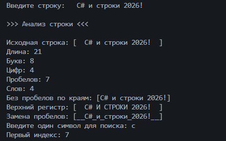

# Практическая работа №19

Автор: Магдеев Заур
Группа: ИСП-254

## Тема

Строки в C#.

## Что реализовано

- определение длины строки;
- подсчёт букв, цифр, пробелов и слов;
- поиск первого индекса символа;
- удаление пробелов по краям;
- перевод в верхний регистр;
- замена пробелов на подчёркивания.

## Короткие ответы

1. string это строка, char это символ

2. Строки неизменяемы Trim() возвращает новую строку, а text остаётся прежним

3. Убирает пустые части от лишних пробелов чтобы они не считались словами

## Результат 
